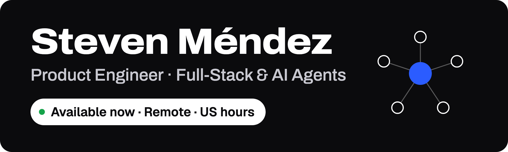
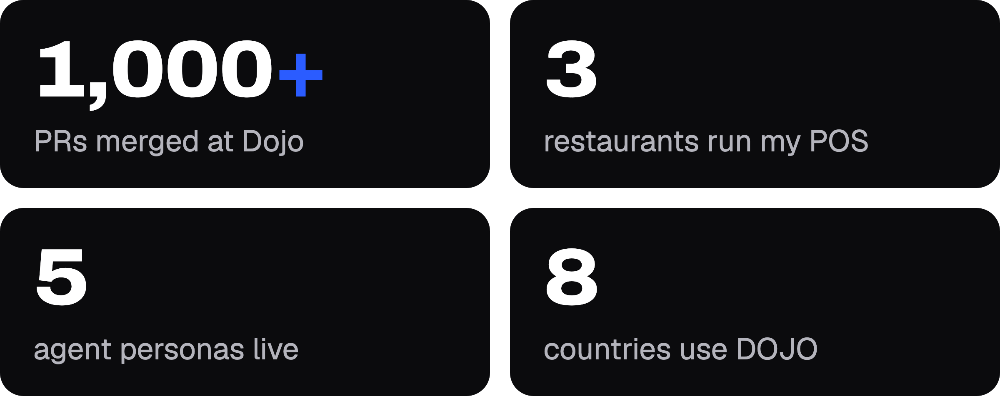

Product engineer in Costa Rica. I take products from the first conversation to production — discovery, database and security, backend, design system, frontend, payments and launch — with Claude in the loop at every layer. If it can be automated, I automate it.

## What I've built

### DOJO · [trydojo.io](https://www.trydojo.io)

Learn, build, get paid and launch: the platform for tech talent in Latin America, used in 8 countries. Software Engineer at Dojo Coding Labs, Dec 2025 – Oct 2026.

- **[Doji](https://www.trydojo.io), the AI agent** — five personas (The Mentor, The Tech Lead, The Founder, The Connector, The Guide) behind a router, with semantic search on pgvector, RLS-safe SQL tools, developer matching and project intake. Live in the app and on WhatsApp through the WhatsApp Business API, with voice notes, opt-out and account linking.
- **[Projects](https://www.trydojo.io/projects)** — notarial-grade marketplace: Stripe Connect escrow, dual-signature attestations, milestone gates, dispute resolution and stake-weighted reputation. 11 pgTAP RLS suites passing.
- **[Pathways](https://www.trydojo.io/pathways)** — the learning engine: courses, Mux video lessons, quizzes, assignments and verifiable certificates.
- **CRM + MCP connector** — the company CRM, fed by signature-verified webhooks for Meta leads and WhatsApp, and operated from Claude by the ops team through an MCP server.

`React 19` `TypeScript` `Vite` `Supabase` `pgvector` `Stripe Connect` `Mux` `Gemini` `MCP`

### MenteFut · [mentefutbol.com](https://www.mentefutbol.com)

AI mental coaching for footballers, narrated by Jeaustin Campos, the winningest coach in Costa Rican football history. Diagnostic quiz on four pillars, AI-generated audio sessions, PDF kits and a 30-day plan, with Stripe one-time and monthly plans and an admin retention dashboard. Lead developer.

`Next.js 16` `Supabase` `Stripe` `Gemini`

### Hikari Intelligence Platform

Investor platform for a fund holding: KYC onboarding state machine, portfolios and transactions, a daily-accrual subledger with DECIMAL precision, an audit trail across 7 tables, an affiliate network and an admin back office, 57 screens in all. Lead developer; scaffold to v1.0-beta in 3 days.

`React` `TypeScript` `Supabase` `Postgres` `Vitest`

### Fischer POS

Point of sale running every day in 3 restaurants across Costa Rica: orders, kitchen tickets, inventory, cash count, payroll and Costa Rica electronic invoicing (Hacienda). Owners ask Claude about their sales through an OAuth 2.1 MCP server.

`React` `Supabase` `Hono` `MCP` `OAuth 2.1`

### DIESSA OS · in development

Water telemetry and remote control for rural aqueducts: tank level, flow, pressure, water quality and pump health on one mobile dashboard. Leading a 3-person team. Demo at [diessa-os.vercel.app](https://diessa-os.vercel.app).

`Next.js` `Supabase`

### Client sites

- **[Rusz Shop](https://ruszshop.com)** — sneaker and streetwear store with ONVO checkout and an admin panel.
- **[Darlope Travels](https://darlopetravels.com)** — private transfers from Liberia airport, with a booking system, ONVO payments and a CRM.
- **Box Architects** — real estate on Google Maps 3D with land polygons and a private due-diligence portal. Pitched at Blockchain Jungle 2025.

## How I work

> Ship the system, not the snippet. Hardening before users. Clarity is the bottleneck.

Observation first: I spend time with the people who live with the problem before any architecture decision. Then Claude in the loop at every layer (schema, security review, refactors) with code review and CI as the safety net.

## Stack

**Frontend** `React 19` `Next.js` `TypeScript` `Vite` `Tailwind` `shadcn/ui` `TanStack Query` 
**Backend & data** `Supabase` `Postgres` `RLS` `Edge Functions` `Node.js` `Hono` `Python` `FastAPI` 
**AI** `Claude API` `Claude Code` `Gemini` `OpenAI` `MCP` `RAG` `pgvector` 
**Payments & infra** `Stripe Connect` `Vercel` `GitHub Actions` 
**Observability** `PostHog` `Sentry` `Langfuse`

## Certifications

**Anthropic** — Building with the Claude API · Claude Code in Action · Introduction to Agent Skills 
**Google** — Foundations of Data Science · Get Started with Python 
**IBM** — Introduction to Software Engineering · Introduction to Cloud Computing

## Let's talk

[rodri.stevenmendez@gmail.com](mailto:rodri.stevenmendez@gmail.com) · [LinkedIn](https://www.linkedin.com/in/steven-mendez-4277602ba/) · [Download my CV](Steven-Mendez-CV.pdf)
