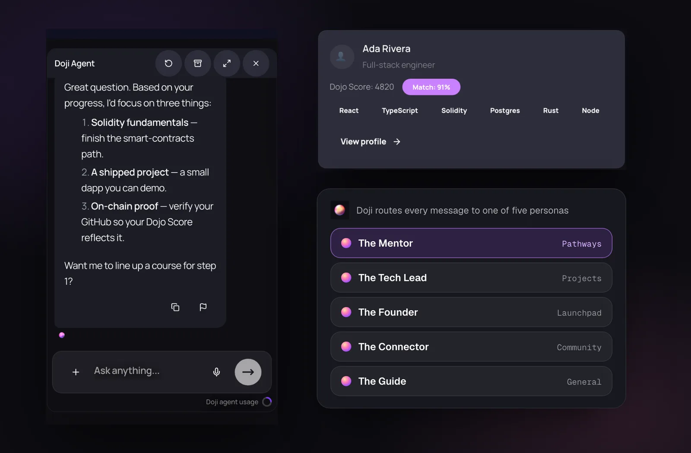
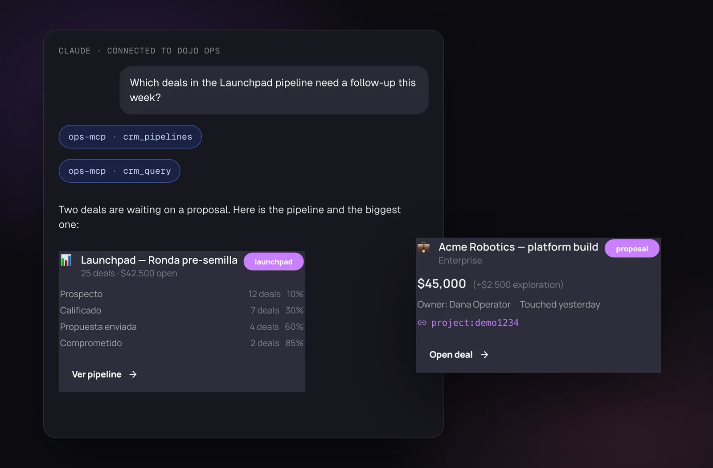
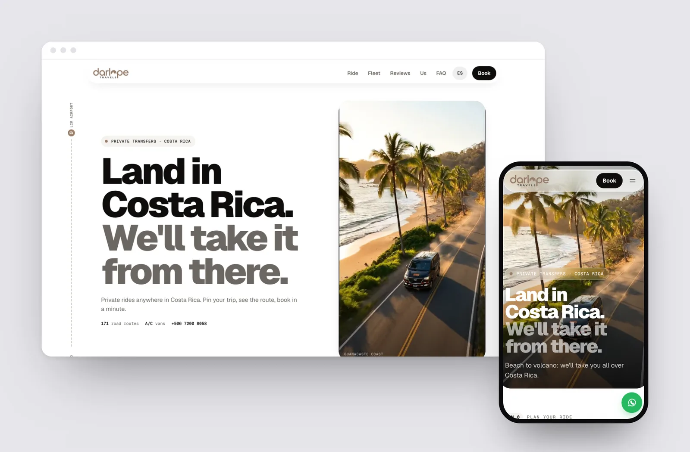
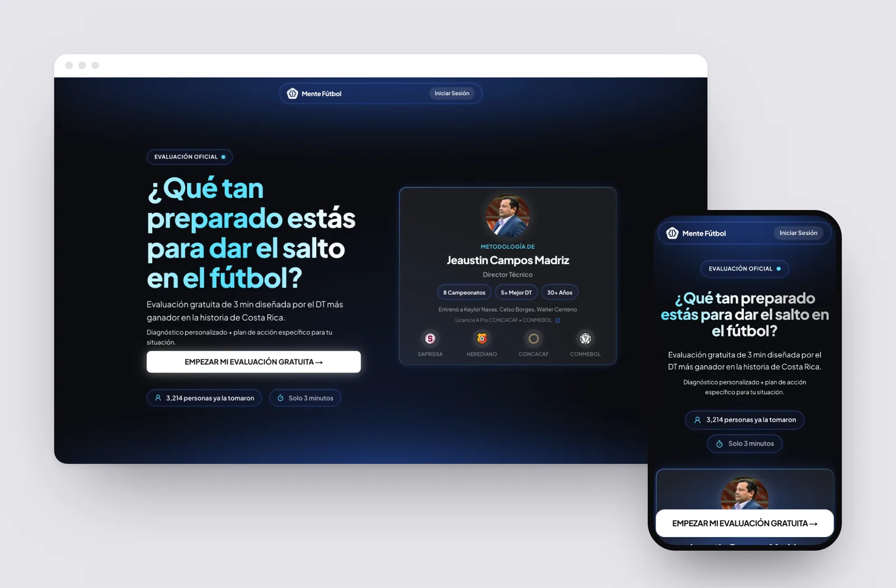
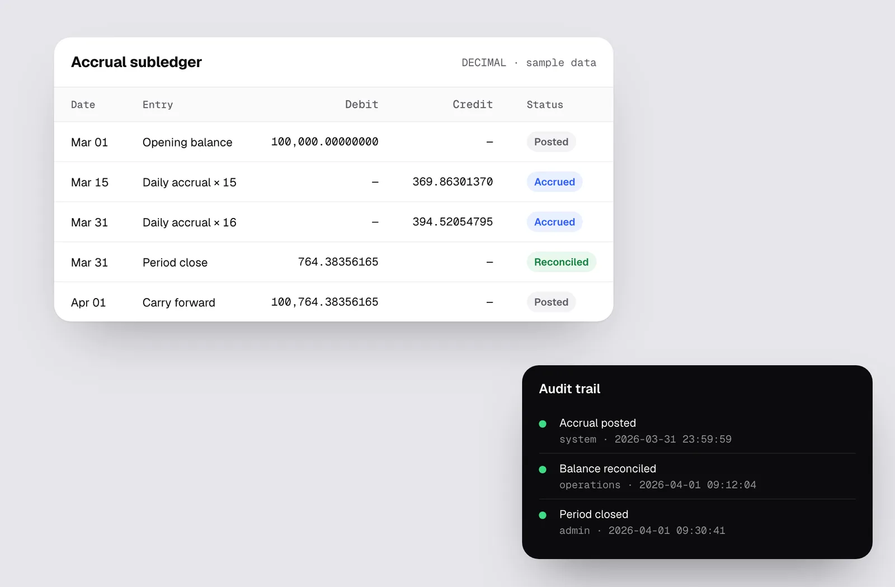
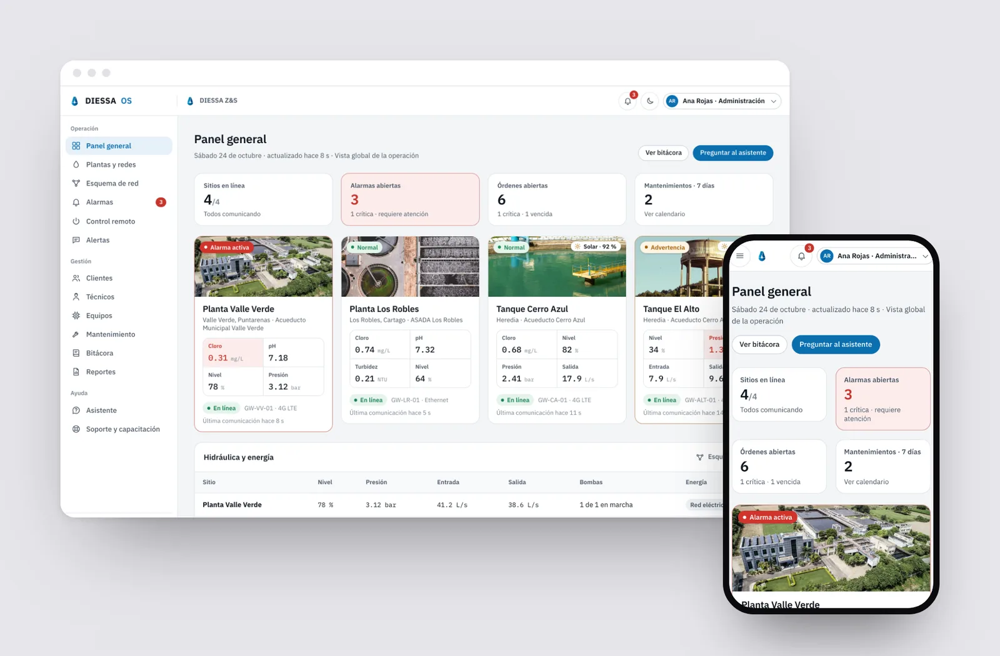
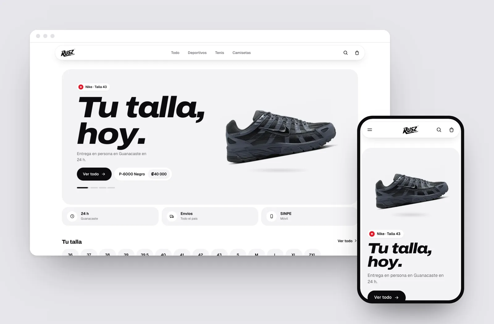

Product engineer in Costa Rica. I take products from the first conversation to production — discovery, database and security, backend, design system, frontend, payments and launch — with Claude in the loop at every layer. If it can be automated, I automate it.

## What I've built

### AI at DOJO · [trydojo.io](https://www.trydojo.io)

 

I built the AI layer of DOJO, the platform for tech talent in Latin America used in 8 countries. Software Engineer at Dojo Coding Labs, Dec 2025 – Oct 2026.

- **[Doji](https://www.trydojo.io), the AI agent** — a plugin for the OpenClaw gateway with five personas behind a router (The Mentor, The Tech Lead, The Founder, The Connector, The Guide) on Gemini 2.5 Flash and Pro. 9 tools: semantic search over 4 pgvector domains, read-only SQL with RLS and whitelisted tables, a 100-point developer match, a 3-phase Socratic project intake, Dojo Score, course and co-founder matching, and memory across sessions. Generative UI: it answers with live interface components, not only text.
- **WhatsApp agent** — Doji on WhatsApp through the WhatsApp Business API: voice notes, a guest mode with the catalog, account linking, sign-up from the chat and opt-out. The same plugin serves Slack and Discord.
- **Guardrails** — JWT auth and rate limits before the agent starts, PII-leak detection and prompt-injection blocking on every message, an audit log of every tool call and an LLM judge that scores tool output.
- **MCP connector + CRM** — the company CRM, fed by signature-verified webhooks for Meta leads and WhatsApp, and run from Claude by the ops team through an MCP server: pipelines, deals and live queries.
- **Also on the platform** — [Projects](https://www.trydojo.io/projects), a notarial-grade marketplace with Stripe Connect escrow, dual-signature attestations and 11 pgTAP RLS suites; and [Pathways](https://www.trydojo.io/pathways), the learning engine, where I teach [Software Engineering Fundamentals · SWE-201](https://www.trydojo.io/pathways/courses/software-development-fundamentals-swe-201).

`Gemini 2.5` `OpenClaw` `MCP` `pgvector` `WhatsApp Business API` `Supabase Edge Functions` `React 19` `TypeScript` `Stripe Connect`

### Restaurant POS + e-invoicing · [Sunset Café](https://shack-surf-cafe.vercel.app)

Point of sale with Costa Rica electronic invoicing, running every day in 3 restaurants, among them Sunset Café, a beach café and bar in Playa Marbella, Guanacaste. My own product: I designed it, built it and support it in production.

- **Electronic invoicing with Hacienda** — invoices, tickets and credit notes as signed XML, validated against Hacienda's schemas, sent to the Ministry of Finance and emailed to the customer as PDF + XML. Several issuers on the same tablet (businesses under different tax IDs), consecutive numbers reserved atomically in Postgres so two tablets never collide, and "fix an invoice" in one tap: credit note + new invoice.
- **The floor** — tables, takeout and QR orders, kitchen printer tickets, customer tabs, inventory, cash count and weekly payroll. Works offline on the tablets and merges changes when the connection comes back.
- **Claude connector** — owners ask Claude for the day's summary, sales, expenses and financial health through an OAuth 2.1 MCP server.

`React` `TypeScript` `Vite` `Supabase` `Postgres` `Hono` `Vercel` `MCP` `OAuth 2.1`

### Darlope Travels · [darlopetravels.com](https://darlopetravels.com)

Booking system and CRM for a private-transfer company in Costa Rica. Travelers price and book rides from Liberia airport on the website; the owner, the office and 5 drivers run the day from one panel: requests, trips, the driver live on the map, a trip link for the traveler and a cash log. The CRM follows every lead by channel (web or WhatsApp) from new to in conversation to booked. Payments with ONVO.

`React Router 7` `TypeScript` `Supabase` `ONVO` `WhatsApp` `PWA`

### MenteFut · [mentefutbol.com](https://www.mentefutbol.com)

AI mental coaching for footballers, narrated by Jeaustin Campos, the winningest coach in Costa Rican football history. Diagnostic quiz on four pillars, AI-generated audio sessions, PDF kits and a 30-day plan, with Stripe one-time and monthly plans and an admin retention dashboard. Lead developer.

`Next.js 16` `Supabase` `Stripe` `Gemini`

### Hikari Intelligence Platform

Investor platform for a fund holding: KYC onboarding state machine, portfolios and transactions, a daily-accrual subledger with DECIMAL precision, an audit trail across 7 tables, an affiliate network and an admin back office, 57 screens in all. Lead developer; scaffold to v1.0-beta in 3 days.

`React` `TypeScript` `Supabase` `Postgres` `Vitest`

### DIESSA OS · in development

Water telemetry and remote control for rural aqueducts: tank level, flow, pressure, water quality and pump health on one mobile dashboard. Leading a 3-person team. Demo at [diessa-os.vercel.app](https://diessa-os.vercel.app).

`Next.js` `Supabase`

### Rusz Shop · [ruszshop.com](https://ruszshop.com)

Sneaker and streetwear store for a client, with ONVO checkout and an admin panel.

## How I work

> Ship the system, not the snippet. Hardening before users. Clarity is the bottleneck.

Observation first: I spend time with the people who live with the problem before any architecture decision. Then Claude in the loop at every layer (schema, security review, refactors) with code review and CI as the safety net.

## Stack

**Frontend** `React 19` `Next.js` `TypeScript` `Vite` `Tailwind` `shadcn/ui` `TanStack Query` 
**Backend & data** `Supabase` `Postgres` `RLS` `Edge Functions` `Node.js` `Hono` `Python` `FastAPI` 
**AI** `Claude API` `Claude Code` `Gemini` `OpenAI` `MCP` `RAG` `pgvector` 
**Payments & infra** `Stripe Connect` `Vercel` `GitHub Actions` 
**Observability** `PostHog` `Sentry` `Langfuse`

## Certifications

**Course I teach** — [Software Engineering Fundamentals · SWE-201](https://www.trydojo.io/pathways/courses/software-development-fundamentals-swe-201) on DOJO Pathways · 8 modules · beginner

| Certificate | Issuer | Credential |
|---|---|---|
| Building with the Claude API |  Anthropic | [Show credential ↗](https://verify.skilljar.com/c/ru3tfnwbih7h) |
| Claude Code in Action |  Anthropic | [Show credential ↗](https://verify.skilljar.com/c/bows5ph8ioze) |
| Building with the Claude API |  Anthropic | [Show credential ↗](https://verify.skilljar.com/c/ru3tfnwbih7h) |
| Introduction to Agent Skills |  Anthropic | [Show credential ↗](https://verify.skilljar.com/c/3s3hkuby3ikt) |
| Building with the Claude API |  Anthropic | [Show credential ↗](https://verify.skilljar.com/c/ru3tfnwbih7h) |
| Foundations of Data Science |  Google · Coursera | [Show credential ↗](https://www.coursera.org/account/accomplishments/verify/8ZRX13R7INNN) |
| Get Started with Python |  Google · Coursera | [Show credential ↗](https://www.coursera.org/account/accomplishments/verify/BZAIPFFPN8SN) |
| Go Beyond the Numbers: Translate Data into Insights |  Google · Coursera | [Show credential ↗](https://www.coursera.org/account/accomplishments/verify/RNTPMN4R7IPU) |
| Introduction to Software Engineering |  IBM · Coursera | [Show credential ↗](https://www.coursera.org/account/accomplishments/verify/XO6Z3HFQRDOA) |
| Introduction to Cloud Computing |  IBM · Coursera | [Show credential ↗](https://www.coursera.org/account/accomplishments/verify/LBNCLBNQVAS1) |
| IA Generativa, LLM Apps, Agentes IA |  Udemy | [Show credential ↗](https://www.udemy.com/certificate/UC-144eeef4-07c6-4132-bcc1-328732d7976b/) |
| The Complete Full-Stack Web Development Bootcamp |  Udemy | [Show credential ↗](https://www.udemy.com/certificate/UC-ff9a203d-ebaf-495f-a2ea-c1d0bdaac4cd/) |
| 100 Days of Code: The Complete Python Pro Bootcamp |  Udemy | [Show credential ↗](https://www.udemy.com/certificate/UC-40efb957-1598-459e-b26f-e82954716766/) |
| Curso completo de Python: Programación en Python desde cero |  Udemy | [Show credential ↗](https://www.udemy.com/certificate/UC-92e2a394-e5cb-47a0-b1ab-aa2732ac74c7/) |
| The Ultimate Beginners Course for Computer Science or IT |  Udemy | [Show credential ↗](https://www.udemy.com/certificate/UC-c2c764b8-b981-4a8a-88f8-3b1b7d29cd06/) |

## Let's talk

**Open to work** · remote · US hours

[rodri.stevenmendez@gmail.com](mailto:rodri.stevenmendez@gmail.com) · [LinkedIn](https://www.linkedin.com/in/steven-mendez-4277602ba/) · [Download my CV](Steven-Mendez-CV.pdf)
